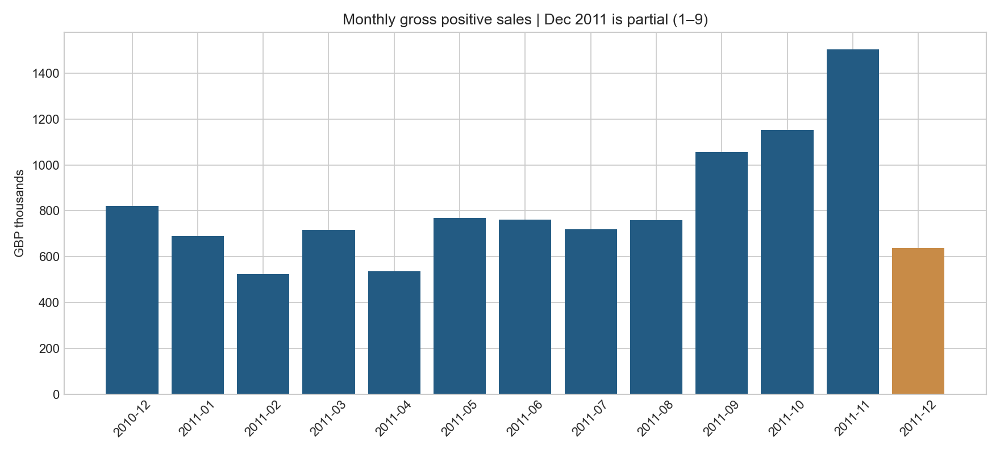
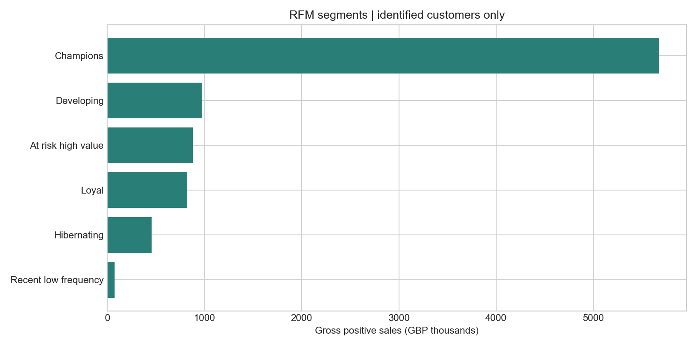
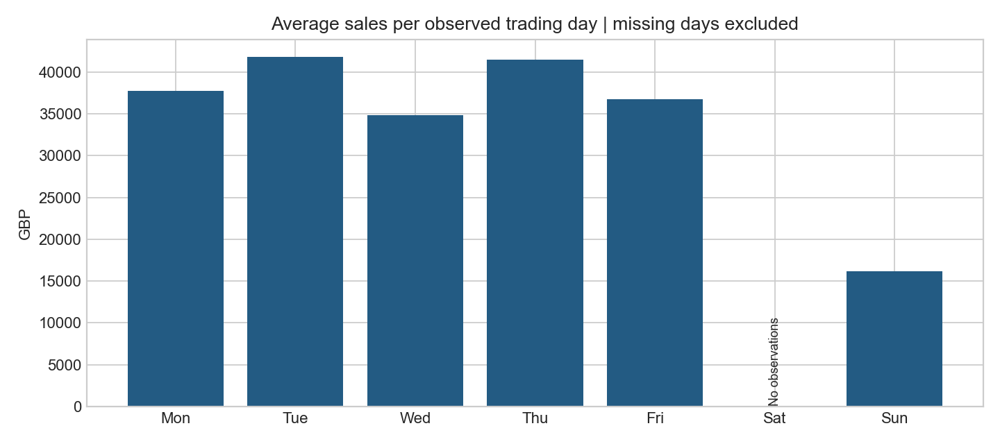

# Customer Behavior & Sales Analytics

**Python · SQL (SQLite) · Pandas · Matplotlib · RFM**

Gerçek perakende işlem verisini ham Excel dosyasından denetlenebilir analiz tablolarına ve görsellere dönüştüren portföy projesi. Polonya'daki Data Science / Data Analytics staj başvurularında veri hazırlama, SQL, keşifsel analiz ve müşteri segmentasyonu becerilerini göstermek için hazırlanmıştır.

## İş soruları

1. Aylık satış tutarı, sipariş ve müşteri sayısı nasıl değişiyor?
2. Yüksek değerli, sadık ve yeniden etkileşim fırsatı olan müşteriler kimler?
3. Hangi ülkeler ve ürün kodları satış tutarında öne çıkıyor?
4. Gözlenen aylık ve haftalık örüntüler operasyon planlamasına nasıl katkı sağlayabilir?

## Veri kaynağı ve atıf

[UCI Online Retail](https://archive.ics.uci.edu/dataset/352/online-retail), Chen, D. (2015), DOI: [10.24432/C5BW33](https://doi.org/10.24432/C5BW33), **CC BY 4.0**. Kaynak, İngiltere merkezli bir çevrim içi perakendeciye ait 1 Aralık 2010–9 Aralık 2011 dönemini kapsayan 541.909 işlem satırı içerir. Para birimi GBP'dir. Polonya verisi değildir; proje staj başvurusu için hazırlanmıştır.

Ham veri doğrudan UCI'den indirilir; sentetik veri kullanılmaz. `data/source_manifest.json` kaynak adresini ve incelenmiş Excel dosyasının SHA-256 özetini saklar. Sonraki çalıştırmalarda dosya özeti uyuşmazsa akış durur. İnternet bağlantısı yalnızca ilk indirmede gereklidir. Kaynak dosya depo içine sürümlenmez.

## Kurulum ve çalıştırma

Python **3.12** ile doğrulanmıştır. Terminali bu README'nin bulunduğu klasörde açın.

Windows PowerShell:

```powershell
py -3.12 -m venv .venv
.\.venv\Scripts\python.exe -m pip install -r requirements-lock.txt
.\.venv\Scripts\python.exe src/pipeline.py
.\.venv\Scripts\python.exe -m unittest discover -s tests -v
```

macOS / Linux:

```bash
python3.12 -m venv .venv
.venv/bin/python -m pip install -r requirements-lock.txt
.venv/bin/python src/pipeline.py
.venv/bin/python -m unittest discover -s tests -v
```

İlk çalıştırmada yaklaşık 23 MB indirilir. Ham Excel'in okunması birkaç dakika sürebilir. Yeniden çalıştırma çıktıları günceller; indirmeyi tekrarlamaz. Ağ kullanmadan çalıştırmak için `src/pipeline.py --offline` kullanın. `requirements.txt` doğrudan bağımlılıkları, `requirements-lock.txt` doğrulanan ortamın tüm sürümlerini içerir. SQLite Python ile birlikte gelir.

## Analiz akışı

`UCI XLSX → Pandas temizleme → SQLite sales + products → SQL raporları → Pandas RFM → CSV + PNG + kalite raporu`

- Her satır bir fatura kalemidir. Sipariş sayısı `COUNT(DISTINCT invoice_no)` ile hesaplanır.
- Tamamen aynı satırlar kaldırılır. Bu, kaynak satırlarında benzersiz kalem kimliği olmadığından bilinçli bir varsayımdır; bazı gerçek tekrarlar da elenebilir.
- Geçersiz zorunlu alanlar, iptal kodları, sıfır/negatif miktar ve fiyatlar sırayla elenir. `quality_report.json` birbirini dışlayan bir eleme dökümü verir.
- Müşteri kimliği eksik pozitif satışlar genel satış analizinde korunur; RFM'den çıkarılır. Ürün açıklaması eksikliği tek başına satış silme nedeni değildir.
- Para tutarları, kaynakta bulunan 0,001 GBP hassasiyetini koruyan tamsayılarla toplanır; yalnızca sunumda iki ondalık basamak gösterilir.
- İptal ve negatif hareketler satış kapsamından çıkarılır; orijinal faturayla iade eşleştirmesi yapılmaz. **Raporlanan tutar net gelir veya kâr değil, temizlenmiş brüt pozitif satıştır.** Kargo ve diğer ürün dışı kodlar korunur.
- `products`, her stok kodu için zaman sırasındaki son dolu açıklamayı içerir. SQL `LEFT JOIN` ile ürün analizi üretilir ve birleşimin satır sayısını değiştirmediği doğrulanır. Açıklamalar tarihsel ürün boyutu değildir.
- Dönem sonuna göre sabitlenen snapshot tarihi kullanılır; bugünün tarihi kullanılmadığı için RFM tekrarlanabilir.

## RFM yöntemi

Recency = snapshot tarihi − son pozitif alışveriş tarihi (gün). Frequency = farklı pozitif fatura sayısı. Monetary = pozitif alışveriş tutarı. Tüm mevcut geçmiş kullanılır.

Her metrik, eşit değerlere aynı puanı veren ortalama yüzdelik sıralama ile 1–5 puanlanır; düşük recency daha yüksek puandır. Eşitlikler nedeniyle gruplar tam yüzde 20 büyüklüğünde olmayabilir. Aşağıdaki ilk eşleşen kural uygulanır:

| Segment | Kural |
|---|---|
| Champions | R ≥ 4, F ≥ 4, M ≥ 4 |
| At risk high value | R ≤ 2 ve (F ≥ 4 veya M ≥ 4) |
| Recent low frequency | R ≥ 4, F ≤ 2 |
| Loyal | F ≥ 4 |
| Hibernating | R ≤ 2 |
| Developing | Diğer müşteriler |

Bu, açıklanabilir kural tabanlı segmentasyondur. Eğitilmiş makine öğrenmesi modeli veya churn tahmini değildir. Segment adları iş hipotezidir; kampanya başarısını kanıtlamaz.

## Sonuçlar

Gerçek çalıştırmanın sayısal sonuçları: [Türkçe bulgu raporu](reports/findings_tr.md). Tüm CSV çıktıları `reports/tables/` altında bulunur.







**Yorum sınırları:** Aralık 2011 yalnızca 1–9 günlerini kapsar; aylık büyüme hesaplanmaz. Bir yıllık döngü kalıcı mevsimselliği doğrulamak için yeterli değildir. Haftanın günleri grafiği yalnızca satış gözlenen günlerin ortalamasıdır; satış gözlenmeyen tarihler sıfır varsayılmaz. Müşteri kimliği eksikliği, toptancı müşteriler ve uç siparişler genellemeyi sınırlar. Nedensellik, tahmin başarısı veya kampanya kaynaklı gelir artışı iddia edilmez.

## Doğrulama

Akış her çalışmada satır eleme toplamını, pozitif miktar/fiyat koşulunu, SQL–Pandas aylık tutar eşitliğini, müşteri bazlı toplam tutar ve sipariş sayılarını ve SQL birleşim kardinalitesini kontrol eder. Kontrol hatası çalıştırmayı başarısız kılar. Ayrı testler iptal, tekrar, anonim müşteri, bozuk tarih, fiyat hassasiyeti ve RFM eşitliklerini kapsar. `reports/quality_report.json` son gerçek veri çalıştırmasının sonucudur. GitHub Actions, küçük testleri çalıştırır; tam veri akışı yerelde veya isteğe bağlı workflow ile çalıştırılır.

## Dosyalar

| Yol | Amaç |
|---|---|
| `src/pipeline.py` | İndirme, temizleme, analiz ve görseller |
| `sql/` | Bağımsız okunabilir SQL sorguları |
| `tests/` | Kenar durum testleri |
| `data/source_manifest.json` | Kaynak ve bütünlük kaydı |
| `data/processed/retail.sqlite` | Yeniden üretilebilen veritabanı; Git dışında |
| `reports/` | Bulgular, kalite raporu, CSV ve PNG çıktıları |
| `docs/cv_and_interview_tr.md` | Kanıta dayalı CV maddeleri ve mülakat notları |

## GitHub'a koyma

Bu klasörün içeriğini yeni bir GitHub deposuna ekleyin. `.gitignore` ham veriyi, veritabanını ve sanal ortamı dışarıda tutar. Kod, SQL, testler, kaynak manifesti ve raporlar depoya dahildir. Veri lisansı CC BY 4.0'dır; kod MIT lisansıyla sunulur.
